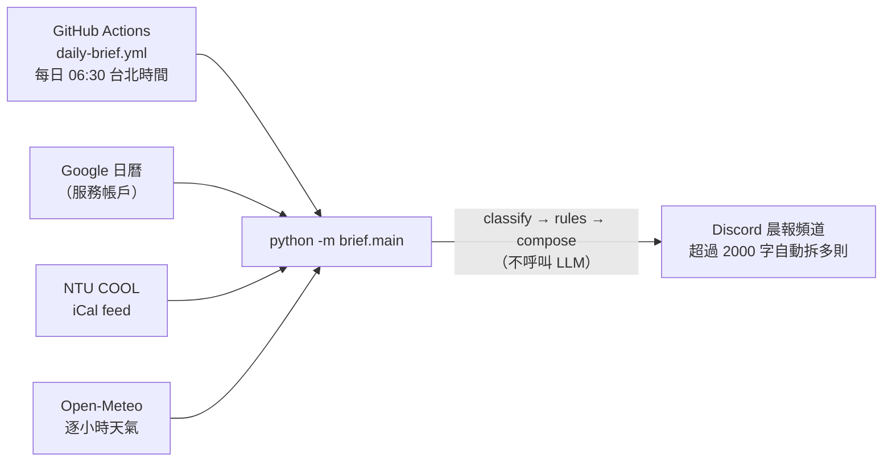

# 個人 AI 助手

邱彥碩的個人 AI 助手專案。目前版本 **v1.0.0：日曆提醒晨報**——每天早上 06:30（台北時間）在
Discord 傳一則訊息：今天的行程、該注意的死線提醒、台北天氣。這一版不使用任何 LLM，全部用規則算。

> 這份文件只放「這是什麼、架構長怎樣、怎麼跑起來」。
> 每個階段做了什麼改動 → 看 [CHANGELOG.md](CHANGELOG.md)。
> 還沒做的事 / 待辦 → 看 [TODO.md](TODO.md)。
> 專案背景 → 看 [CLAUDE.md](CLAUDE.md)（內容描述的是 v0.x 的目標，部分已不適用）。

## 架構總覽

單一 workflow，讀三個來源、算規則、直接傳文字到 Discord，不寫回 repo。



### 訊息內容

- **每天**：標題（日期 + 星期）、天氣（氣溫範圍、最高降雨機率 + 一句帶傘／外套建議）、
  📅 今天（當天所有事件）、⏰ 提醒（依規則觸發）
- **只有週一**：📆 本週（今天 ~ +6 天，按日期分組）
- 當天沒有事件也照發，空的區塊會寫「今天沒有排程」等

### 事件標題格式

| 來源 | 格式 | 範例 |
|---|---|---|
| 手動（Google 日曆） | `類型 課名 內容`，類型＝作業／考試／專題／其他（其他沒有課名） | `作業 計網 HW2`、`其他 一德社課` |
| NTU COOL | `作業名稱 [課名 (課號)]`，一律視為作業 | `Homework 1 [機器人知覺與學習 (CSIE5117)]` |

兩種都對不上 → 當作「其他」並加上 `⚠️格式不符`，提醒去改標題。

### 提醒規則（`brief/rules.py` 的 `REMINDER_RULES`，d = 事件日期 − 今天）

| 類型 | 觸發的 d |
|---|---|
| 考試 | 5、1 |
| 專題 | 14、7、1 |
| 作業 | 2 |
| 其他 | 1 |

天氣建議的門檻（降雨 40%、全天最低溫 16°C、晚上最低溫 18°C 等，外套只看絕對溫度、不看
日夜溫差）在 `brief/weather.py` 開頭。

## 專案結構

```
brief/                       v1.0.0 日曆提醒晨報
  main.py                     進入點：--dry-run（只印不發）、--date YYYY-MM-DD（假裝是某天）
  config.py                   環境變數、時區（Asia/Taipei）、查詢範圍（+15 天）
  classify.py                 標題解析 → Event(type, course, title, date, time, source)
  rules.py                    提醒規則設定 + 今天／提醒／本週的篩選
  weather.py                  天氣建議（純邏輯）
  compose.py                  組訊息、拆 2000 字
  send.py                     傳 Discord（沿用舊版 bot 與頻道）
  sources/
    google_calendar.py        Google Calendar API（服務帳戶）
    cool_feed.py              NTU COOL iCal feed
    weather.py                Open-Meteo 逐小時預報
tests/                        pytest：classify / rules / compose / 天氣建議（不打 API）

.github/workflows/
  daily-brief.yml             每日 22:30 UTC（= 台北 06:30）+ 手動觸發
  test.yml                    PR 上跑 pytest
  keepalive.yml               每月 1 號重新 enable daily-brief.yml（公開 repo 60 天沒活動時
                                GitHub 會自動停用排程，這支避免晨報被停掉）
  morning-report.yml          v0.x，未使用（已在 GitHub 上停用）
  send-morning-link.yml       v0.x，未使用（監聽 docs/data/**，新版不會寫那裡，所以不會觸發）
```

## 需要的 GitHub Secrets

| Secret | 用途 |
|---|---|
| `GOOGLE_SERVICE_ACCOUNT_JSON` | 服務帳戶 JSON 金鑰的完整內容 |
| `GOOGLE_CALENDAR_ID` | 要讀的 Google 日曆 ID（已共用給服務帳戶） |
| `COOL_CALENDAR_FEED_URL` | NTU COOL 行事曆訂閱網址（含私人 token） |
| `DISCORD_BOT_TOKEN` | 沿用舊版的 Discord bot |

頻道 ID 預設 `1547445470555807794`（`morning_report/config.py`），可用
`DISCORD_MORNING_BRIEF_CHANNEL_ID` 覆蓋。

> ⚠️ `schedule` 和 `workflow_dispatch` 只看預設分支（`main`）上的 workflow，merge 之後 06:30
> 的排程才會生效。

## 本機測試

複製 `.env.example` 為 `.env` 並填入值。本機的服務帳戶金鑰用 `GOOGLE_SERVICE_ACCOUNT_FILE`
指到 repo 外的檔案路徑即可（金鑰檔不可進 git）。

```powershell
pip install -r requirements.txt pytest
python -m pytest
python -m brief.main --dry-run
python -m brief.main --dry-run --date 2026-11-09
```

⚠️ 不加 `--dry-run` 就是真的發到 Discord 頻道。

---

## 舊版（v0.x）功能，目前未使用

以下程式碼原封不動保留，但不再執行。是否移除見 TODO.md。

- `morning_report/`：三段接力 pipeline（GitHub Actions 蒐集 Discord 待辦／收藏連結 + HN、Google
  新聞、YouTube、Devpost、Eventbrite 多來源搜尋 → Claude Code routine 寫內容 → `apply_content.py`
  寫看板資料 → `send-morning-link.yml` 推看板網址到 Discord）
  - 其中 `sources/weather_source.py` 的座標與 `sources/discord_source.py` 的 API base 仍被
    v1.0.0 引用（只 import 常數，舊程式沒改）
  - `config.py` 仍被 v1.0.0 用來讀 `.env` 與 Discord token／頻道 ID
- `docs/`：GitHub Pages 看板網站（Broadsheet 報紙風），支援 `?date=YYYY-MM-DD` 回看歷史
- `memory/`：長期記憶（Gemini 對話匯入、profile／habits／interests／feedback）
- `design_handoff_morning_brief/`：Broadsheet 視覺規格交接文件
- `.github/workflows/morning-report.yml`、`send-morning-link.yml`

舊版的詳細架構說明請看 git 歷史中 v0.5.0 的 README（commit `892fa0e`）。
